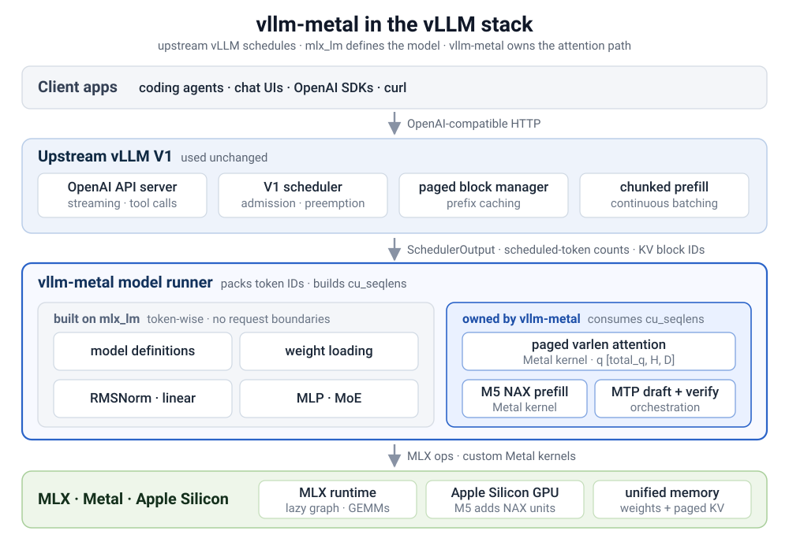

# vlLM on Apple silicon GPU

## Background

### vLLM-Metal

For GPU-accelerated inference on Apple Silicon, use vLLM-Metal, a community-maintained hardware plugin that uses MLX as the compute backend and provides native GPU acceleration via Apple's Metal framework.

vLLM-Metal works with MLX-optimized models from the mlx-community organization on Hugging Face, which provides quantized versions of popular models optimized for Apple Silicon.

Local inference on a Mac is straightforward until several requests overlap. Then time to first token (TTFT), memory growth, and admission control become serving problems rather than model-execution problems. vllm-metal brings vLLM's scheduler, paged KV cache, and OpenAI-compatible server to Apple Silicon, with MLX and Metal handling execution.



Our first official release, v0.28.0 (2026.9.1), aligned vllm-metal's version numbering with upstream vLLM. It introduced batched multi-token prediction (MTP), GGUF and hybrid-model support, and faster prefill on M5. You can install v0.29.0 (2026.9.11) with Homebrew.

### Metal

The Metal framework gives your app direct access to a device’s graphics processing unit (GPU). With Metal, apps can leverage a GPU to quickly render complex scenes and run computational tasks in parallel.

### MLX

MLX is an array framework for machine learning on Apple silicon, brought to you by Apple machine learning research. The design of MLX is inspired by frameworks like NumPy, PyTorch, Jax, and ArrayFire.

### mlx-lm

MLX LM is a Python package for generating text and fine-tuning large language models on Apple silicon with MLX.

## Install stable release with Homebrew

### Install

Install the stable release:

```
brew tap vllm-project/vllm-metal https://github.com/vllm-project/vllm-metal
brew install -v vllm-project/vllm-metal/vllm-metal
```

使用`-v`选项，能够输出详细的日志，否则看起来长时间卡住。关键日志如下：

```
❯ brew install -v vllm-project/vllm-metal/vllm-metal
...
==> Verifying checksum for '5178b5b5a7668cf1d56184e53e6ee2608ed47790eb0b3a6464bace8b20dfafda--vllm-0.31.0+cpu-cp312-cp312-macosx_11_0_arm64.whl'
==> Fetching downloads for: vllm-metal
==> Verifying checksum for '89a3de3ed776a9bcfc63a066f77fd21cd5b9954a4829ca8d134acb3e2294d8fb--vllm_metal-0.31.0-cp312-cp312-macosx_15_0_arm64.whl'
✔︎ Formula vllm-metal (0.31.0)                                                                                                                                                          Verified      4.3MB/  4.3MB
✔︎ Resource vllm-metal--vllm                                                                                                                                                            Verified     29.5MB/ 29.5MB
==> Installing vllm-metal from vllm-project/vllm-metal
...
==> Verifying checksum for '89a3de3ed776a9bcfc63a066f77fd21cd5b9954a4829ca8d134acb3e2294d8fb--vllm_metal-0.31.0-cp312-cp312-macosx_15_0_arm64.whl'
cp -p /Users/maochenxiao/Library/Caches/Homebrew/downloads/89a3de3ed776a9bcfc63a066f77fd21cd5b9954a4829ca8d134acb3e2294d8fb--vllm_metal-0.31.0-cp312-cp312-macosx_15_0_arm64.whl /private/tmp/s-SCwhr7Gb/vllm-metal-20261015-43183-7z4twa/vllm_metal-0.31.0-cp312-cp312-macosx_15_0_arm64.whl
==> python3.12 -m venv /opt/homebrew/Cellar/vllm-metal/0.31.0/libexec
==> /opt/homebrew/Cellar/vllm-metal/0.31.0/libexec/bin/pip install /private/tmp/s-SCwhr7Gb/vllm-metal-20261015-43183-7z4twa/vllm-0.31.0+cpu-cp312-cp312-macosx_11_0_arm64.whl /private/tmp/s-SCwhr7Gb/vllm-metal-20261015-43183-7z4twa/vllm_metal-0.31.0-cp312-cp312-macosx_15_0_arm64.whl
Processing ./vllm-0.31.0+cpu-cp312-cp312-macosx_11_0_arm64.whl
Processing ./vllm_metal-0.31.0-cp312-cp312-macosx_15_0_arm64.whl
...
Collecting mlx==0.32.1 (from vllm-metal==0.31.0)
  Using cached mlx-0.32.1-cp312-cp312-macosx_26_0_arm64.whl.metadata (5.9 kB)
...
Collecting mlx-lm @ git+https://github.com/ml-explore/mlx-lm@9e6acca691e64d6d8bb808c328fcdea459099cca (from vllm-metal==0.31.0)
  Cloning https://github.com/ml-explore/mlx-lm (to revision 9e6acca691e64d6d8bb808c328fcdea459099cca) to /private/tmp/s-SCwhr7Gb/pip-install-00ngrxh6/mlx-lm_d75c79183b7741e988c15bce9862328b
  Running command git clone --filter=blob:none --quiet https://github.com/ml-explore/mlx-lm /private/tmp/s-SCwhr7Gb/pip-install-00ngrxh6/mlx-lm_d75c79183b7741e988c15bce9862328b
  Running command git rev-parse -q --verify '9e6acca691e64d6d8bb808c328fcdea459099cca^{commit}'
  9e6acca691e64d6d8bb808c328fcdea459099cca
  Running command git checkout -q 9e6acca691e64d6d8bb808c328fcdea459099cca
  Resolved https://github.com/ml-explore/mlx-lm to commit 9e6acca691e64d6d8bb808c328fcdea459099cca
  Installing build dependencies: started
  Installing build dependencies: finished with status 'done'
  Getting requirements to build wheel: started
  Getting requirements to build wheel: finished with status 'done'
  Preparing metadata (pyproject.toml): started
  Preparing metadata (pyproject.toml): finished with status 'done'
...
Collecting mlx-metal==0.32.1 (from mlx==0.32.1->vllm-metal==0.31.0)
  Using cached mlx_metal-0.32.1-py3-none-macosx_26_0_arm64.whl.metadata (5.1 kB)
...
Building wheels for collected packages: mlx-lm
  Building wheel for mlx-lm (pyproject.toml): started
  Building wheel for mlx-lm (pyproject.toml): finished with status 'done'
  Created wheel for mlx-lm: filename=mlx_lm-0.32.0-py3-none-any.whl size=429081 sha256=d3afa658e03d44340ca5ab5b648b6f9061027431c7bc616e8504a41038fd236f
  Stored in directory: /Users/maochenxiao/Library/Caches/Homebrew/pip_cache/wheels/92/73/9c/174b6aa0f74f83976ed623a2af6eb4efc212bf10213da41948
Successfully built mlx-lm
Installing collected packages: torchaudio, supervisor, py-cpuinfo, nanobind, mpmath, websockets, uvloop, urllib3, typing_extensions, truststore, tqdm, torchcodec, sympy, sniffio, six, shellingham, setuptools, setproctitle, sentencepiece, safetensors, rpds-py, rignore, regex, pyzmq, pyyaml, python-multipart, python-json-logger, python-dotenv, pyjwt, pygments, pycparser, pycountry, pybase64, psutil, protobuf, propcache, prometheus_client, pillow, partial-json-parser, packaging, outlines_core, numpy, ninja, networkx, multidict, msgspec, mlx-metal, mdurl, MarkupSafe, loguru, llvmlite, llguidance, lark, jmespath, jiter, interegular, ijson, idna, httptools, hf-xet, h11, fsspec, frozenlist, filelock, fastar, einops, docstring-parser, dnspython, dill, detect-installer, cloudpickle, click, charset_normalizer, certifi, cbor2, cachetools, blake3, attrs, astor, annotated-types, annotated-doc, aiohappyeyeballs, agent-detector, yarl, uvicorn, typing-inspection, sentry-sdk, scipy, requests, referencing, pydantic-core, opentelemetry-proto, opentelemetry-api, opencv-python-headless, opencv-python, numba, mlx, markdown-it-py, jinja2, httpcore2, httpcore, grpcio, googleapis-common-protos, email-validator, depyf, cffi, apache-tvm-ffi, anyio, aiosignal, watchfiles, torch, tiktoken, starlette, sounddevice, rich, pydantic, opentelemetry-semantic-conventions, opentelemetry-exporter-otlp-proto-common, opentelemetry-exporter-http-transport, miniaudio, jsonschema-specifications, httpx2, httpx, cryptography, aiohttp, typer, torchvision, sse-starlette, rich-toolkit, pydantic-settings, pydantic-extra-types, prometheus-fastapi-instrumentator, oss-harmony, opentelemetry-sdk, openai, mcp-types, lm-format-enforcer, jsonschema, huggingface_hub, fastapi, anthropic, tokenizers, opentelemetry-semantic-conventions-ai, opentelemetry-exporter-otlp-common, model-hosting-container-standards, mcp, fastapi-cloud-cli, fastapi-cli, accelerate, transformers, opentelemetry-exporter-otlp-proto-http, opentelemetry-exporter-otlp-proto-grpc, mistral_common, xgrammar, opentelemetry-exporter-otlp, mlx-lm, mlx-audio, compressed-tensors, mlx-vlm, vllm-metal, vllm
Successfully installed MarkupSafe-3.0.4 accelerate-1.15.0 ...
...
==> Finishing up
ln -s ../Cellar/vllm-metal/0.31.0/bin/vllm vllm
ln -s ../Cellar/vllm-metal/0.31.0/share/vllm-metal vllm-metal
Warning: Calling `post_install` is deprecated! Use `post_install_steps` instead.
==> Summary
🍺  /opt/homebrew/Cellar/vllm-metal/0.31.0: 62,951 files, 1.9GB, built in 5 minutes
...
==> Caveats
==> vllm-metal
Start a server with:
  vllm serve <model>

Python and the vLLM Metal plugin are installed in a private environment.
No virtual environment activation is needed.
```

从以上日志可以看到：

* mlx, mlx-metal, vllm, vllm-metal都是预编译好的wheel
* mlx-lm是指定了源码分支构建的
* 最终安装在`/opt/homebrew/Cellar/vllm-metal/0.31.0`

### Serve

保留完整日志，供细看。

```
❯ vllm serve Qwen/Qwen3.5-0.8B --gpu-memory-utilization 0.5
W1017 20:46:09.298000 58627 torch/_library/triton.py:53] Triton not available, find_triton_kernels = []
(APIServer pid=58627) INFO 10-17 20:46:09 [api_utils.py:347]
(APIServer pid=58627) INFO 10-17 20:46:09 [api_utils.py:347]        █     █     █▄   ▄█
(APIServer pid=58627) INFO 10-17 20:46:09 [api_utils.py:347]  ▄▄ ▄█ █     █     █ ▀▄▀ █  version 0.31.0
(APIServer pid=58627) INFO 10-17 20:46:09 [api_utils.py:347]   █▄█▀ █     █     █     █  model   Qwen/Qwen3.5-0.8B
(APIServer pid=58627) INFO 10-17 20:46:09 [api_utils.py:347]    ▀▀  ▀▀▀▀▀ ▀▀▀▀▀ ▀     ▀
(APIServer pid=58627) INFO 10-17 20:46:09 [api_utils.py:347]
(APIServer pid=58627) INFO 10-17 20:46:09 [api_utils.py:286] non-default args: {'model_tag': 'Qwen/Qwen3.5-0.8B', 'model': 'Qwen/Qwen3.5-0.8B', 'gpu_memory_utilization': 0.5}
(APIServer pid=58627) WARNING 10-17 20:46:09 [system_utils.py:249] Found ulimit of 2048 and failed to automatically increase with error current limit exceeds maximum limit. This can cause fd limit errors like `OSError: [Errno 24] Too many open files`. Consider increasing with ulimit -n
Warning: You are sending unauthenticated requests to the HF Hub. Please set a HF_TOKEN to enable higher rate limits and faster downloads.
(APIServer pid=58627) INFO 10-17 20:46:14 [model.py:699] Resolved architecture: Qwen3_5ForConditionalGeneration
(APIServer pid=58627) INFO 10-17 20:46:14 [model.py:2109] Using max model len 262144
(APIServer pid=58627) INFO 10-17 20:46:16 [config.py:643] Mamba cache mode is set to 'align' for Qwen3_5ForConditionalGeneration by default when prefix caching is enabled
Parse safetensors files: 100%|██████████████████████████████████████████████████████████████████████████████████████████████████████████████████████████████████████████████████████| 1/1 [00:04<00:00,  4.21s/it]
(APIServer pid=58627) INFO 10-17 20:46:21 [kernel.py:408] Final IR op priority after setting platform defaults: IrOpPriorityConfig(rms_norm=['native'], fused_add_rms_norm=['native'], gelu_and_mul_sparse=['native'])
(APIServer pid=58627) INFO 10-17 20:46:21 [platform.py:873] Metal: chunked prefill enabled (paged attention), max_num_batched_tokens=2048
(APIServer pid=58627) INFO 10-17 20:46:21 [platform.py:992] Metal memory: 19.3GB total, 5.6GB available
(EngineCore pid=59113) INFO 10-17 20:46:38 [core.py:129] Initializing a V1 LLM engine (v0.31.0) with config: model='Qwen/Qwen3.5-0.8B', speculative_config=None, tokenizer='Qwen/Qwen3.5-0.8B', skip_tokenizer_init=False, tokenizer_mode=auto, revision=main, tokenizer_revision=main, trust_remote_code=False, dtype=torch.bfloat16, max_seq_len=262144, download_dir=None, load_format=auto, tensor_parallel_size=1, pipeline_parallel_size=1, data_parallel_size=1, decode_context_parallel_size=1, dcp_comm_backend=ag_rs, disable_custom_all_reduce=True, quantization=None, quantization_config=None, enforce_eager=False, aux_output_config=AuxOutputConfig(enable_return_routed_experts=False, max_bytes=None), kv_cache_dtype=auto, device_config=cpu, structured_outputs_config=StructuredOutputsConfig(backend='auto', disable_any_whitespace=False, disable_additional_properties=False, reasoning_parser='', reasoning_parser_plugin='', enable_in_reasoning=False), observability_config=ObservabilityConfig(show_hidden_metrics_for_version=None, otlp_traces_endpoint=None, collect_detailed_traces=None, per_request_spec_decode_metrics='none', kv_cache_metrics=False, kv_cache_metrics_sample=0.01, cudagraph_metrics=False, enable_layerwise_nvtx_tracing=False, enable_mfu_metrics=False, enable_mm_processor_stats=False, enable_logging_iteration_details=False, jit_monitor_mode='warn', jit_monitor_verbose=False), seed=0, served_model_name=Qwen/Qwen3.5-0.8B, enable_prefix_caching=True, enable_chunked_prefill=True, pooler_config=None, compilation_config={'mode': <CompilationMode.VLLM_COMPILE: 3>, 'debug_dump_path': None, 'cache_dir': '', 'compile_cache_save_format': 'binary', 'backend': 'inductor', 'custom_ops': ['none'], 'ir_enable_torch_wrap': True, 'splitting_ops': ['vllm::unified_attention_with_output', 'vllm::unified_mla_attention_with_output', 'vllm::mamba_mixer2', 'vllm::mamba_mixer', 'vllm::short_conv', 'vllm::qwen4_exp_ple_short_conv', 'vllm::qwen4_exp_qsa_with_output', 'vllm::linear_attention', 'vllm::qwen_gdn_attention_core', 'vllm::qwen_gdn_attention_core_fused_norm_packed', 'vllm::gdn_attention_core_xpu', 'vllm::olmo_hybrid_gdn_full_forward', 'vllm::sparse_attn_indexer', 'vllm::rocm_aiter_sparse_attn_indexer', 'vllm::deepseek_v4_attention', 'vllm::hpc_rope_norm_forward', 'vllm::unified_kv_cache_update', 'vllm::unified_mla_kv_cache_update'], 'compile_mm_encoder': False, 'cudagraph_mm_encoder': False, 'encoder_cudagraph_token_budgets': [], 'encoder_cudagraph_max_vision_items_per_batch': 0, 'encoder_cudagraph_max_frames_per_batch': None, 'compile_sizes': None, 'compile_ranges_endpoints': [2048], 'inductor_compile_config': {'enable_auto_functionalized_v2': False, 'combo_kernels': True, 'benchmark_combo_kernel': True}, 'inductor_passes': {}, 'cudagraph_mode': <CUDAGraphMode.NONE: 0>, 'cudagraph_num_of_warmups': 0, 'cudagraph_capture_sizes': None, 'cudagraph_copy_inputs': False, 'cudagraph_specialize_lora': True, 'use_inductor_graph_partition': False, 'pass_config': {'fuse_norm_quant': False, 'fuse_act_quant': False, 'fuse_attn_quant': False, 'enable_sp': False, 'fuse_gemm_comms': False, 'fuse_allreduce_rms': False, 'enable_qk_norm_rope_fusion': False, 'fuse_rope_kvcache_cat_mla': False, 'fuse_act_padding': False, 'fuse_qk_norm_rope_kvcache': False}, 'max_cudagraph_capture_size': None, 'dynamic_shapes_config': {'type': <DynamicShapesType.BACKED: 'backed'>, 'evaluate_guards': False, 'assume_32_bit_indexing': False}, 'local_cache_dir': None, 'fast_moe_cold_start': False, 'static_all_moe_layers': []}, kernel_config=KernelConfig(ir_op_priority=IrOpPriorityConfig(rms_norm=['native'], fused_add_rms_norm=['native'], gelu_and_mul_sparse=['native']), enable_flashinfer_autotune=True, enable_cutedsl_warmup=True, enable_jit_warmup=True, moe_backend='auto', sparse_indexer_topk_backend='auto', linear_backend='auto', linear_backend_per_quant=None)
W1017 20:46:38.972000 59113 torch/_library/triton.py:53] Triton not available, find_triton_kernels = []
(EngineCore pid=59113) INFO 10-17 20:46:39 [worker.py:137] MLX device set to: Device(gpu, 0)
(EngineCore pid=59113) INFO 10-17 20:46:39 [utils.py:170] Set Metal wired_limit to 13.3 GB
(EngineCore pid=59113) INFO 10-17 20:46:39 [worker.py:145] PyTorch device set to: mps
(EngineCore pid=59113) INFO 10-17 20:46:39 [parallel_state.py:1825] world_size=1 rank=0 local_rank=0 distributed_init_method=file:///var/folders/7g/nmg6_hj17hn31qmn93dt0r400000gn/T/vllm_dist_524e34bd300a468494f91787a400669d backend=gloo
[W1017 20:46:39.743135000 ProcessGroupGloo.cpp:555] Warning: Unable to resolve hostname to a (local) address. Using the loopback address as fallback. Manually set the network interface to bind to with GLOO_SOCKET_IFNAME. (function operator())
(EngineCore pid=59113) INFO 10-17 20:46:39 [parallel_state.py:2269] rank 0 in world size 1 is assigned as DP rank 0, PP rank 0, PCP rank 0, TP rank 0, ETP rank 0, EP rank N/A, EPLB rank N/A
Fetching 10 files: 100%|████████████████████████████████████████████████████████████████████████████████████████████████████████████████████████████████████████████████████████| 10/10 [00:00<00:00, 5367.68it/s]
Download complete:                                                                                                                                                                            |  0.00B
Reconstruction complete: |                                                                                                                                                           |  0.00B /  0.00B
(EngineCore pid=59113) INFO 10-17 20:46:41 [model_lifecycle.py:427] MLX-VLM model loaded in 1.14s: Qwen/Qwen3.5-0.8B
(EngineCore pid=59113) INFO 10-17 20:46:41 [model_adapter.py:790] Metal: LanguageModel output head is not reproducible outside its forward; using full logits.
(EngineCore pid=59113) WARNING 10-17 20:46:41 [platform.py:1211] Hybrid model with paged attention enabled. Using block-size translation (PR #235) to convert vLLM's large block_size to a Metal kernel-compatible size.
(EngineCore pid=59113) WARNING 10-17 20:46:41 [platform.py:1211]   Mechanism: Each vLLM block is split into multiple kernel blocks.
(EngineCore pid=59113) WARNING 10-17 20:46:41 [platform.py:1211]   Example: vLLM block_size=144 → kernel block_size=16 (ratio=9).
(EngineCore pid=59113) WARNING 10-17 20:46:41 [platform.py:1211]   The KV cache is reshaped (zero-copy) and block tables are expanded.
(EngineCore pid=59113) WARNING 10-17 20:46:41 [platform.py:1211]   This is a logical transformation — physical memory is unchanged.
(EngineCore pid=59113) INFO 10-17 20:46:41 [interface.py:989] Setting attention block size to 544 tokens to ensure that attention page size is >= mamba page size.
(EngineCore pid=59113) INFO 10-17 20:46:41 [interface.py:1013] Padding mamba page size by 2.64% to ensure that mamba page size and attention page size are exactly equal.
(EngineCore pid=59113) INFO 10-17 20:46:41 [utils.py:343] Using LBNHC KV cache layout.
(EngineCore pid=59113) INFO 10-17 20:46:42 [cache_policy.py:1424] Paged attention: using --gpu-memory-utilization=0.50
(EngineCore pid=59113) INFO 10-17 20:46:42 [cache_policy.py:1353] KV commit probe: forced 512 MiB resident in 0.05s: available 2.4->2.5 GiB, compressed +18 MiB, swap out +0 MiB; holding back 1.07 GB for the rest of the machine
(EngineCore pid=59113) WARNING 10-17 20:46:42 [cache_policy.py:1373] KV commit probe: the pool (3.35 GB) is larger than this machine's free memory (2.60 GB). An idle pool does not need those blocks; blocks a request writes will page. forced 512 MiB resident in 0.05s: available 2.4->2.5 GiB, compressed +18 MiB, swap out +0 MiB
(EngineCore pid=59113) INFO 10-17 20:46:42 [cache_policy.py:1134] Upstream cache layout: reporting 3.35 GB KV budget; runtime allocation deferred until vLLM KVCacheConfig
(EngineCore pid=59113) INFO 10-17 20:46:42 [kv_cache_utils.py:2464] CPU KV cache size: 269,127 tokens, Maximum concurrency for 262,144 tokens per request: 1.03x
(EngineCore pid=59113) INFO 10-17 20:46:43 [__init__.py:344] Native paged-attention Metal kernels loaded
(EngineCore pid=59113) INFO 10-17 20:46:43 [hybrid.py:122] Hybrid shared cache: 501 blocks, 3.12 GiB backing for KV and state
(EngineCore pid=59113) INFO 10-17 20:46:43 [cache_policy.py:658] KV cache config received: 501 grouped blocks (MLX layout initialized from vLLM config)
(EngineCore pid=59113) INFO 10-17 20:46:43 [model_runner.py:1299] Warming up model...
(EngineCore pid=59113) INFO 10-17 20:46:43 [model_runner.py:1303] Model warm-up complete
(EngineCore pid=59113) INFO 10-17 20:46:43 [__init__.py:363] Warming up v2 paged-attention Metal kernels...
(EngineCore pid=59113) INFO 10-17 20:46:43 [__init__.py:371] Paged-attention Metal kernel warm-up complete
(EngineCore pid=59113) INFO 10-17 20:46:43 [core.py:373] init engine (profile, create kv cache, warmup model) took 1.72 s (compilation: 0.03 s)
[transformers] Qwen3VL video processing does not apply the per-frame pixel cap the reference implementation (qwen-vl-utils) applies, so some videos cost far more tokens than they would there. In v5.22 the capped behavior will become the default and `cap_pixels_per_frame` will be removed. Pass `cap_pixels_per_frame=True` to adopt the reference behavior now, or `False` to keep the current behavior and silence this warning.
(APIServer pid=58627) INFO 10-17 20:46:44 [base.py:255] Multi-modal warmup completed in 10.944s
(EngineCore pid=59113) INFO 10-17 20:46:45 [kv_cache_utils.py:772] kv cache group sizes [544, 544, 544, 544]
(EngineCore pid=59113) INFO 10-17 20:46:45 [kv_cache_utils.py:773] kv lcm block sizes 544
Warning: You are sending unauthenticated requests to the HF Hub. Please set a HF_TOKEN to enable higher rate limits and faster downloads.
Parse safetensors files: 100%|██████████████████████████████████████████████████████████████████████████████████████████████████████████████████████████████████████████████████████| 1/1 [00:11<00:00, 11.56s/it]
(EngineCore pid=59113) INFO 10-17 20:47:06 [kernel.py:408] Final IR op priority after setting platform defaults: IrOpPriorityConfig(rms_norm=['native'], fused_add_rms_norm=['native'], gelu_and_mul_sparse=['native'])
(EngineCore pid=59113) INFO 10-17 20:47:06 [platform.py:873] Metal: chunked prefill enabled (paged attention), max_num_batched_tokens=2048
(EngineCore pid=59113) INFO 10-17 20:47:06 [platform.py:992] Metal memory: 19.3GB total, 4.3GB available
(APIServer pid=58627) INFO 10-17 20:47:06 [entry.py:132] Supported tasks: ['generate']
(APIServer pid=58627) INFO 10-17 20:47:06 [factories.py:76] Scale-out endpoints are disabled. Set --enable-scale-out to enable them.
(APIServer pid=58627) INFO 10-17 20:47:14 [hf.py:646] Detected the chat template content format to be 'openai'. You can set `--chat-template-content-format` to override this.
(APIServer pid=58627) WARNING 10-17 20:47:15 [serving.py:221] The chat template requires system-first ordering, so inline system messages in /v1/messages requests (e.g. Claude Code's per-turn reminders) are merged into the leading system prompt. Each new one changes the prompt prefix, so the rest of the conversation misses the prefix cache. Pass a --chat-template that accepts non-leading system messages to avoid this.
(APIServer pid=58627) WARNING 10-17 20:47:16 [serving.py:221] The chat template requires system-first ordering, so inline system messages in /v1/messages requests (e.g. Claude Code's per-turn reminders) are merged into the leading system prompt. Each new one changes the prompt prefix, so the rest of the conversation misses the prefix cache. Pass a --chat-template that accepts non-leading system messages to avoid this.
(APIServer pid=58627) INFO 10-17 20:47:16 [entry.py:136] Starting vLLM server on http://0.0.0.0:8000
(APIServer pid=58627) INFO 10-17 20:47:16 [launcher.py:60] Available routes are:
(APIServer pid=58627) INFO 10-17 20:47:16 [launcher.py:69] Route: /openapi.json, Methods: HEAD, GET
(APIServer pid=58627) INFO 10-17 20:47:16 [launcher.py:69] Route: /docs, Methods: HEAD, GET
(APIServer pid=58627) INFO 10-17 20:47:16 [launcher.py:69] Route: /docs/oauth2-redirect, Methods: HEAD, GET
(APIServer pid=58627) INFO 10-17 20:47:16 [launcher.py:69] Route: /redoc, Methods: HEAD, GET
(APIServer pid=58627) INFO 10-17 20:47:16 [launcher.py:69] Route: /load, Methods: GET
(APIServer pid=58627) INFO 10-17 20:47:16 [launcher.py:69] Route: /version, Methods: GET
(APIServer pid=58627) INFO 10-17 20:47:16 [launcher.py:69] Route: /kv_event_sources, Methods: GET
(APIServer pid=58627) INFO 10-17 20:47:16 [launcher.py:69] Route: /health, Methods: GET
(APIServer pid=58627) INFO 10-17 20:47:16 [launcher.py:69] Route: /metrics, Methods: GET
(APIServer pid=58627) INFO 10-17 20:47:16 [launcher.py:69] Route: /tokenize, Methods: POST
(APIServer pid=58627) INFO 10-17 20:47:16 [launcher.py:69] Route: /detokenize, Methods: POST
(APIServer pid=58627) INFO 10-17 20:47:16 [launcher.py:69] Route: /v1/models, Methods: GET
(APIServer pid=58627) INFO 10-17 20:47:16 [launcher.py:69] Route: /ping, Methods: GET
(APIServer pid=58627) INFO 10-17 20:47:16 [launcher.py:69] Route: /ping, Methods: POST
(APIServer pid=58627) INFO 10-17 20:47:16 [launcher.py:69] Route: /invocations, Methods: POST
(APIServer pid=58627) INFO 10-17 20:47:16 [launcher.py:69] Route: /v1/chat/completions, Methods: POST
(APIServer pid=58627) INFO 10-17 20:47:16 [launcher.py:69] Route: /v1/chat/completions/batch, Methods: POST
(APIServer pid=58627) INFO 10-17 20:47:16 [launcher.py:69] Route: /v1/responses, Methods: POST
(APIServer pid=58627) INFO 10-17 20:47:16 [launcher.py:69] Route: /v1/responses/{response_id}, Methods: GET
(APIServer pid=58627) INFO 10-17 20:47:16 [launcher.py:69] Route: /v1/responses/{response_id}/cancel, Methods: POST
(APIServer pid=58627) INFO 10-17 20:47:16 [launcher.py:69] Route: /v1/completions, Methods: POST
(APIServer pid=58627) INFO 10-17 20:47:16 [launcher.py:69] Route: /v1/messages, Methods: POST
(APIServer pid=58627) INFO 10-17 20:47:16 [launcher.py:69] Route: /v1/messages/count_tokens, Methods: POST
(APIServer pid=58627) INFO 10-17 20:47:16 [launcher.py:69] Route: /generative_scoring, Methods: POST
(APIServer pid=58627) INFO 10-17 20:47:16 [launcher.py:69] Route: /scale_elastic_ep, Methods: POST
(APIServer pid=58627) INFO 10-17 20:47:16 [launcher.py:69] Route: /is_scaling_elastic_ep, Methods: POST
INFO:     Started server process [58627]
INFO:     Waiting for application startup.
INFO:     Application startup complete.
```

要点：

* 只有APIServer和EngineCore，没有Worker进程
* MLX device set to: Device(gpu, 0)
* MLX-VLM model loaded in 1.14s: Qwen/Qwen3.5-0.8B

## Install latest dev build with the curl installer

### Install

```
❯ curl -fsSL https://raw.githubusercontent.com/vllm-project/vllm-metal/main/install.sh | bash
Fetching dev release...

=== Installing vLLM core ===
Wheel: vLLM 0.31.0 (prebuilt macOS arm64)
Using Python 3.12.13 environment at: /Users/maochenxiao/.venv-vllm-metal
Resolved 147 packages in 2m 26s
Prepared 2 packages in 8m 46s
Uninstalled 10 packages in 1.27s
Installed 16 packages in 350ms
 - click==8.4.1
 + click==8.5.0
 - fastapi==0.137.0
 + fastapi==0.136.3
 - hf-xet==1.5.1
 + hf-xet==1.7.0
 + httpcore2==2.13.1
 + httpx2==2.13.1
 - huggingface-hub==1.19.0
 + huggingface-hub==1.33.0
 - mcp==1.27.2
 + mcp==2.3.0
 + mcp-types==2.3.0
 - mistral-common==1.11.3
 + mistral-common==1.12.0
 + oss-harmony==0.0.11
 - torch==2.11.0
 + torch==2.13.0
 + torchcodec==0.17.0
 - torchvision==0.26.0
 + torchvision==0.28.0
 + truststore==0.10.5
 - vllm==0.23.0+cpu (from file:///private/var/folders/7g/nmg6_hj17hn31qmn93dt0r400000gn/T/tmp.UUxQON0djU/vllm-0.23.0)
 + vllm==0.31.0+cpu (from https://github.com/vllm-project/vllm/releases/download/v0.31.0/vllm-0.31.0%2Bcpu-cp312-cp312-macosx_11_0_arm64.whl)
 - xgrammar==0.2.2
 + xgrammar==0.2.7
✓ Installed vLLM core
Release: v0.31.0.dev20261017044401
Wheel:   vllm_metal-0.31.0.dev20261017044401-cp312-cp312-macosx_15_0_arm64.whl
✓ Found release

Downloading wheel...
✓ Downloaded wheel
Using Python 3.12.13 environment at: /Users/maochenxiao/.venv-vllm-metal
    Updated https://github.com/ml-explore/mlx-lm (9e6acca691e64d6d8bb808c328fcdea459099cca)
Resolved 81 packages in 8.18s
      Built mlx-lm @ git+https://github.com/ml-explore/mlx-lm@9e6acca691e64d6d8bb808c328fcdea459099cca
Prepared 7 packages in 8m 24s
Uninstalled 8 packages in 524ms
Installed 8 packages in 80ms
 - mlx==0.31.2
 + mlx==0.32.2
 - mlx-audio==0.4.4
 + mlx-audio==0.5.9
 - mlx-lm==0.31.3
 + mlx-lm==0.32.0 (from git+https://github.com/ml-explore/mlx-lm@9e6acca691e64d6d8bb808c328fcdea459099cca)
 - mlx-metal==0.31.2
 + mlx-metal==0.32.2
 - mlx-vlm==0.6.3
 + mlx-vlm==0.7.6
 - tokenizers==0.22.2
 + tokenizers==0.23.3
 - transformers==5.12.0
 + transformers==5.17.0
 - vllm-metal==0.3.0.dev20260614085908 (from file:///var/folders/7g/nmg6_hj17hn31qmn93dt0r400000gn/T/tmp.sm2H6MIT73/vllm_metal-0.3.0.dev20260614085908-cp312-cp312-macosx_11_0_arm64.whl)
 + vllm-metal==0.31.0.dev20261017044401 (from file:///var/folders/7g/nmg6_hj17hn31qmn93dt0r400000gn/T/tmp.enqUsJDia3/vllm_metal-0.31.0.dev20261017044401-cp312-cp312-macosx_15_0_arm64.whl)
✓ Installed vllm-metal

✓ Installation complete!

To use vllm, activate the virtual environment:
  source /Users/maochenxiao/.venv-vllm-metal/bin/activate

Or add the venv to your PATH:
  export PATH="/Users/maochenxiao/.venv-vllm-metal/bin:$PATH"
```

以前用同样的方法安装过，所以大部分dependency是更新。

### Serve

保留完整日志，供细看。

```
❯ source /Users/maochenxiao/.venv-vllm-metal/bin/activate
~ via 🐍 v3.12.13 (.venv-vllm-metal)
❯ vllm serve Qwen/Qwen3.5-0.8B --gpu-memory-utilization 0.5
W1017 23:02:10.906000 36212 torch/_library/triton.py:53] Triton not available, find_triton_kernels = []
(APIServer pid=36212) INFO 10-17 23:02:10 [api_utils.py:347]
(APIServer pid=36212) INFO 10-17 23:02:10 [api_utils.py:347]        █     █     █▄   ▄█
(APIServer pid=36212) INFO 10-17 23:02:10 [api_utils.py:347]  ▄▄ ▄█ █     █     █ ▀▄▀ █  version 0.31.0
(APIServer pid=36212) INFO 10-17 23:02:10 [api_utils.py:347]   █▄█▀ █     █     █     █  model   Qwen/Qwen3.5-0.8B
(APIServer pid=36212) INFO 10-17 23:02:10 [api_utils.py:347]    ▀▀  ▀▀▀▀▀ ▀▀▀▀▀ ▀     ▀
(APIServer pid=36212) INFO 10-17 23:02:10 [api_utils.py:347]
(APIServer pid=36212) INFO 10-17 23:02:10 [api_utils.py:286] non-default args: {'model_tag': 'Qwen/Qwen3.5-0.8B', 'model': 'Qwen/Qwen3.5-0.8B', 'gpu_memory_utilization': 0.5}
(APIServer pid=36212) WARNING 10-17 23:02:10 [system_utils.py:249] Found ulimit of 2048 and failed to automatically increase with error current limit exceeds maximum limit. This can cause fd limit errors like `OSError: [Errno 24] Too many open files`. Consider increasing with ulimit -n
Warning: You are sending unauthenticated requests to the HF Hub. Please set a HF_TOKEN to enable higher rate limits and faster downloads.
(APIServer pid=36212) INFO 10-17 23:02:14 [model.py:699] Resolved architecture: Qwen3_5ForConditionalGeneration
(APIServer pid=36212) INFO 10-17 23:02:14 [model.py:2109] Using max model len 262144
(APIServer pid=36212) INFO 10-17 23:02:18 [config.py:643] Mamba cache mode is set to 'align' for Qwen3_5ForConditionalGeneration by default when prefix caching is enabled
Parse safetensors files: 100%|██████████████████████████████████████████████████████████████████████████████████████████████████████████████████████████████████████████████████████| 1/1 [00:04<00:00,  4.73s/it]
(APIServer pid=36212) INFO 10-17 23:02:24 [kernel.py:408] Final IR op priority after setting platform defaults: IrOpPriorityConfig(rms_norm=['native'], fused_add_rms_norm=['native'], gelu_and_mul_sparse=['native'])
(APIServer pid=36212) INFO 10-17 23:02:24 [platform.py:961] Metal: chunked prefill enabled (paged attention), max_num_batched_tokens=2048
(APIServer pid=36212) INFO 10-17 23:02:24 [platform.py:1085] Metal memory: 19.3GB total, 11.2GB available
(EngineCore pid=36217) INFO 10-17 23:02:38 [core.py:129] Initializing a V1 LLM engine (v0.31.0) with config: model='Qwen/Qwen3.5-0.8B', speculative_config=None, tokenizer='Qwen/Qwen3.5-0.8B', skip_tokenizer_init=False, tokenizer_mode=auto, revision=main, tokenizer_revision=main, trust_remote_code=False, dtype=torch.bfloat16, max_seq_len=262144, download_dir=None, load_format=auto, tensor_parallel_size=1, pipeline_parallel_size=1, data_parallel_size=1, decode_context_parallel_size=1, dcp_comm_backend=ag_rs, disable_custom_all_reduce=True, quantization=None, quantization_config=None, enforce_eager=False, aux_output_config=AuxOutputConfig(enable_return_routed_experts=False, max_bytes=None), kv_cache_dtype=auto, device_config=cpu, structured_outputs_config=StructuredOutputsConfig(backend='auto', disable_any_whitespace=False, disable_additional_properties=False, reasoning_parser='', reasoning_parser_plugin='', enable_in_reasoning=False), observability_config=ObservabilityConfig(show_hidden_metrics_for_version=None, otlp_traces_endpoint=None, collect_detailed_traces=None, per_request_spec_decode_metrics='none', kv_cache_metrics=False, kv_cache_metrics_sample=0.01, cudagraph_metrics=False, enable_layerwise_nvtx_tracing=False, enable_mfu_metrics=False, enable_mm_processor_stats=False, enable_logging_iteration_details=False, jit_monitor_mode='warn', jit_monitor_verbose=False), seed=0, served_model_name=Qwen/Qwen3.5-0.8B, enable_prefix_caching=True, enable_chunked_prefill=True, pooler_config=None, compilation_config={'mode': <CompilationMode.VLLM_COMPILE: 3>, 'debug_dump_path': None, 'cache_dir': '', 'compile_cache_save_format': 'binary', 'backend': 'inductor', 'custom_ops': ['none'], 'ir_enable_torch_wrap': True, 'splitting_ops': ['vllm::unified_attention_with_output', 'vllm::unified_mla_attention_with_output', 'vllm::mamba_mixer2', 'vllm::mamba_mixer', 'vllm::short_conv', 'vllm::qwen4_exp_ple_short_conv', 'vllm::qwen4_exp_qsa_with_output', 'vllm::linear_attention', 'vllm::qwen_gdn_attention_core', 'vllm::qwen_gdn_attention_core_fused_norm_packed', 'vllm::gdn_attention_core_xpu', 'vllm::olmo_hybrid_gdn_full_forward', 'vllm::sparse_attn_indexer', 'vllm::rocm_aiter_sparse_attn_indexer', 'vllm::deepseek_v4_attention', 'vllm::hpc_rope_norm_forward', 'vllm::unified_kv_cache_update', 'vllm::unified_mla_kv_cache_update'], 'compile_mm_encoder': False, 'cudagraph_mm_encoder': False, 'encoder_cudagraph_token_budgets': [], 'encoder_cudagraph_max_vision_items_per_batch': 0, 'encoder_cudagraph_max_frames_per_batch': None, 'compile_sizes': None, 'compile_ranges_endpoints': [2048], 'inductor_compile_config': {'enable_auto_functionalized_v2': False, 'combo_kernels': True, 'benchmark_combo_kernel': True}, 'inductor_passes': {}, 'cudagraph_mode': <CUDAGraphMode.NONE: 0>, 'cudagraph_num_of_warmups': 0, 'cudagraph_capture_sizes': None, 'cudagraph_copy_inputs': False, 'cudagraph_specialize_lora': True, 'use_inductor_graph_partition': False, 'pass_config': {'fuse_norm_quant': False, 'fuse_act_quant': False, 'fuse_attn_quant': False, 'enable_sp': False, 'fuse_gemm_comms': False, 'fuse_allreduce_rms': False, 'enable_qk_norm_rope_fusion': False, 'fuse_rope_kvcache_cat_mla': False, 'fuse_act_padding': False, 'fuse_qk_norm_rope_kvcache': False}, 'max_cudagraph_capture_size': None, 'dynamic_shapes_config': {'type': <DynamicShapesType.BACKED: 'backed'>, 'evaluate_guards': False, 'assume_32_bit_indexing': False}, 'local_cache_dir': None, 'fast_moe_cold_start': False, 'static_all_moe_layers': []}, kernel_config=KernelConfig(ir_op_priority=IrOpPriorityConfig(rms_norm=['native'], fused_add_rms_norm=['native'], gelu_and_mul_sparse=['native']), enable_flashinfer_autotune=True, enable_cutedsl_warmup=True, enable_jit_warmup=True, moe_backend='auto', sparse_indexer_topk_backend='auto', linear_backend='auto', linear_backend_per_quant=None)
W1017 23:02:38.423000 36217 torch/_library/triton.py:53] Triton not available, find_triton_kernels = []
(EngineCore pid=36217) INFO 10-17 23:02:38 [worker.py:137] MLX device set to: Device(gpu, 0)
(EngineCore pid=36217) INFO 10-17 23:02:38 [utils.py:170] Set Metal wired_limit to 13.3 GB
(EngineCore pid=36217) INFO 10-17 23:02:38 [worker.py:145] PyTorch device set to: mps
(EngineCore pid=36217) INFO 10-17 23:02:38 [parallel_state.py:1825] world_size=1 rank=0 local_rank=0 distributed_init_method=file:///var/folders/7g/nmg6_hj17hn31qmn93dt0r400000gn/T/vllm_dist_472c1066d9ec460fbaf1711459cbcada backend=gloo
(EngineCore pid=36217) INFO 10-17 23:02:38 [parallel_state.py:2269] rank 0 in world size 1 is assigned as DP rank 0, PP rank 0, PCP rank 0, TP rank 0, ETP rank 0, EP rank N/A, EPLB rank N/A
Fetching 10 files: 100%|████████████████████████████████████████████████████████████████████████████████████████████████████████████████████████████████████████████████████████| 10/10 [00:00<00:00, 6009.03it/s]
Download complete:                                                                                                                                                                            |  0.00B
Reconstruction complete: |                                                                                                                                                           |  0.00B /  0.00B
(EngineCore pid=36217) INFO 10-17 23:02:39 [model_lifecycle.py:427] MLX-VLM model loaded in 0.65s: Qwen/Qwen3.5-0.8B
(EngineCore pid=36217) INFO 10-17 23:02:39 [model_adapter.py:809] Metal: LanguageModel output head is not reproducible outside its forward; using full logits.
(EngineCore pid=36217) WARNING 10-17 23:02:39 [platform.py:1322] Hybrid model with paged attention enabled. Using block-size translation (PR #235) to convert vLLM's large block_size to a Metal kernel-compatible size.
(EngineCore pid=36217) WARNING 10-17 23:02:39 [platform.py:1322]   Mechanism: Each vLLM block is split into multiple kernel blocks.
(EngineCore pid=36217) WARNING 10-17 23:02:39 [platform.py:1322]   Example: vLLM block_size=144 → kernel block_size=16 (ratio=9).
(EngineCore pid=36217) WARNING 10-17 23:02:39 [platform.py:1322]   The KV cache is reshaped (zero-copy) and block tables are expanded.
(EngineCore pid=36217) WARNING 10-17 23:02:39 [platform.py:1322]   This is a logical transformation — physical memory is unchanged.
(EngineCore pid=36217) INFO 10-17 23:02:39 [interface.py:989] Setting attention block size to 544 tokens to ensure that attention page size is >= mamba page size.
(EngineCore pid=36217) INFO 10-17 23:02:39 [interface.py:1013] Padding mamba page size by 2.64% to ensure that mamba page size and attention page size are exactly equal.
(EngineCore pid=36217) INFO 10-17 23:02:39 [utils.py:343] Using LBNHC KV cache layout.
(EngineCore pid=36217) INFO 10-17 23:02:40 [cache_policy.py:1468] Paged attention: using --gpu-memory-utilization=0.50
(EngineCore pid=36217) INFO 10-17 23:02:40 [cache_policy.py:1391] KV commit probe: forced 512 MiB resident in 0.05s: available 5.4->5.6 GiB, compressed +0 MiB, swap out +0 MiB; holding back 1.07 GB for the rest of the machine
(EngineCore pid=36217) INFO 10-17 23:02:40 [cache_policy.py:1155] Upstream cache layout: reporting 3.35 GB KV budget; runtime allocation deferred until vLLM KVCacheConfig
(EngineCore pid=36217) INFO 10-17 23:02:40 [kv_cache_utils.py:2464] CPU KV cache size: 269,127 tokens, Maximum concurrency for 262,144 tokens per request: 1.03x
(EngineCore pid=36217) INFO 10-17 23:02:42 [__init__.py:368] Native paged-attention Metal kernels loaded
(EngineCore pid=36217) INFO 10-17 23:02:42 [hybrid.py:122] Hybrid shared cache: 501 blocks, 3.12 GiB backing for KV and state
(EngineCore pid=36217) INFO 10-17 23:02:42 [cache_policy.py:679] KV cache config received: 501 grouped blocks (MLX layout initialized from vLLM config)
(EngineCore pid=36217) INFO 10-17 23:02:42 [model_runner.py:1428] Warming up model...
(EngineCore pid=36217) INFO 10-17 23:02:42 [model_runner.py:1432] Model warm-up complete
(EngineCore pid=36217) INFO 10-17 23:02:42 [__init__.py:387] Warming up v2 paged-attention Metal kernels...
(EngineCore pid=36217) INFO 10-17 23:02:42 [__init__.py:395] Paged-attention Metal kernel warm-up complete
(EngineCore pid=36217) INFO 10-17 23:02:42 [core.py:373] init engine (profile, create kv cache, warmup model) took 3.45 s (compilation: 0.44 s)
[transformers] Qwen3VL video processing does not apply the per-frame pixel cap the reference implementation (qwen-vl-utils) applies, so some videos cost far more tokens than they would there. In v5.22 the capped behavior will become the default and `cap_pixels_per_frame` will be removed. Pass `cap_pixels_per_frame=True` to adopt the reference behavior now, or `False` to keep the current behavior and silence this warning.
(APIServer pid=36212) INFO 10-17 23:02:44 [base.py:255] Multi-modal warmup completed in 9.832s
(EngineCore pid=36217) INFO 10-17 23:03:01 [kv_cache_utils.py:772] kv cache group sizes [544, 544, 544, 544]
(EngineCore pid=36217) INFO 10-17 23:03:01 [kv_cache_utils.py:773] kv lcm block sizes 544
Warning: You are sending unauthenticated requests to the HF Hub. Please set a HF_TOKEN to enable higher rate limits and faster downloads.
Parse safetensors files: 100%|██████████████████████████████████████████████████████████████████████████████████████████████████████████████████████████████████████████████████████| 1/1 [00:03<00:00,  3.80s/it]
(EngineCore pid=36217) INFO 10-17 23:03:15 [kernel.py:408] Final IR op priority after setting platform defaults: IrOpPriorityConfig(rms_norm=['native'], fused_add_rms_norm=['native'], gelu_and_mul_sparse=['native'])
(EngineCore pid=36217) INFO 10-17 23:03:15 [platform.py:961] Metal: chunked prefill enabled (paged attention), max_num_batched_tokens=2048
(EngineCore pid=36217) INFO 10-17 23:03:15 [platform.py:1085] Metal memory: 19.3GB total, 7.3GB available
(APIServer pid=36212) INFO 10-17 23:03:15 [entry.py:132] Supported tasks: ['generate']
(APIServer pid=36212) INFO 10-17 23:03:15 [factories.py:76] Scale-out endpoints are disabled. Set --enable-scale-out to enable them.
(APIServer pid=36212) INFO 10-17 23:03:20 [hf.py:646] Detected the chat template content format to be 'openai'. You can set `--chat-template-content-format` to override this.
(APIServer pid=36212) WARNING 10-17 23:03:22 [serving.py:221] The chat template requires system-first ordering, so inline system messages in /v1/messages requests (e.g. Claude Code's per-turn reminders) are merged into the leading system prompt. Each new one changes the prompt prefix, so the rest of the conversation misses the prefix cache. Pass a --chat-template that accepts non-leading system messages to avoid this.
(APIServer pid=36212) WARNING 10-17 23:03:22 [serving.py:221] The chat template requires system-first ordering, so inline system messages in /v1/messages requests (e.g. Claude Code's per-turn reminders) are merged into the leading system prompt. Each new one changes the prompt prefix, so the rest of the conversation misses the prefix cache. Pass a --chat-template that accepts non-leading system messages to avoid this.
(APIServer pid=36212) INFO 10-17 23:03:22 [entry.py:136] Starting vLLM server on http://0.0.0.0:8000
(APIServer pid=36212) INFO 10-17 23:03:22 [launcher.py:60] Available routes are:
(APIServer pid=36212) INFO 10-17 23:03:22 [launcher.py:69] Route: /openapi.json, Methods: GET, HEAD
(APIServer pid=36212) INFO 10-17 23:03:22 [launcher.py:69] Route: /docs, Methods: GET, HEAD
(APIServer pid=36212) INFO 10-17 23:03:22 [launcher.py:69] Route: /docs/oauth2-redirect, Methods: GET, HEAD
(APIServer pid=36212) INFO 10-17 23:03:22 [launcher.py:69] Route: /redoc, Methods: GET, HEAD
(APIServer pid=36212) INFO 10-17 23:03:22 [launcher.py:69] Route: /load, Methods: GET
(APIServer pid=36212) INFO 10-17 23:03:22 [launcher.py:69] Route: /version, Methods: GET
(APIServer pid=36212) INFO 10-17 23:03:22 [launcher.py:69] Route: /kv_event_sources, Methods: GET
(APIServer pid=36212) INFO 10-17 23:03:22 [launcher.py:69] Route: /health, Methods: GET
(APIServer pid=36212) INFO 10-17 23:03:22 [launcher.py:69] Route: /metrics, Methods: GET
(APIServer pid=36212) INFO 10-17 23:03:22 [launcher.py:69] Route: /tokenize, Methods: POST
(APIServer pid=36212) INFO 10-17 23:03:22 [launcher.py:69] Route: /detokenize, Methods: POST
(APIServer pid=36212) INFO 10-17 23:03:22 [launcher.py:69] Route: /v1/models, Methods: GET
(APIServer pid=36212) INFO 10-17 23:03:22 [launcher.py:69] Route: /ping, Methods: GET
(APIServer pid=36212) INFO 10-17 23:03:22 [launcher.py:69] Route: /ping, Methods: POST
(APIServer pid=36212) INFO 10-17 23:03:22 [launcher.py:69] Route: /invocations, Methods: POST
(APIServer pid=36212) INFO 10-17 23:03:22 [launcher.py:69] Route: /v1/chat/completions, Methods: POST
(APIServer pid=36212) INFO 10-17 23:03:22 [launcher.py:69] Route: /v1/chat/completions/batch, Methods: POST
(APIServer pid=36212) INFO 10-17 23:03:22 [launcher.py:69] Route: /v1/responses, Methods: POST
(APIServer pid=36212) INFO 10-17 23:03:22 [launcher.py:69] Route: /v1/responses/{response_id}, Methods: GET
(APIServer pid=36212) INFO 10-17 23:03:22 [launcher.py:69] Route: /v1/responses/{response_id}/cancel, Methods: POST
(APIServer pid=36212) INFO 10-17 23:03:22 [launcher.py:69] Route: /v1/completions, Methods: POST
(APIServer pid=36212) INFO 10-17 23:03:22 [launcher.py:69] Route: /v1/messages, Methods: POST
(APIServer pid=36212) INFO 10-17 23:03:22 [launcher.py:69] Route: /v1/messages/count_tokens, Methods: POST
(APIServer pid=36212) INFO 10-17 23:03:22 [launcher.py:69] Route: /generative_scoring, Methods: POST
(APIServer pid=36212) INFO 10-17 23:03:22 [launcher.py:69] Route: /scale_elastic_ep, Methods: POST
(APIServer pid=36212) INFO 10-17 23:03:22 [launcher.py:69] Route: /is_scaling_elastic_ep, Methods: POST
INFO:     Started server process [36212]
INFO:     Waiting for application startup.
INFO:     Application startup complete.
```

## Reference

* https://docs.vllm.ai/en/latest/getting_started/installation/gpu/
* https://docs.vllm.ai/en/latest/cli/
* https://github.com/vllm-project/vllm-metal
* https://github.com/vllm-project/vllm-metal/blob/main/docs/supported_models.md
* https://vllm.ai/blog/2026-09-22-vllm-metal-v0-28-0
* https://developer.apple.com/metal/
* https://github.com/ml-explore/mlx
* https://github.com/ml-explore/mlx-lm
* https://github.com/Blaizzy/mlx-vlm
* https://huggingface.co/mlx-community
